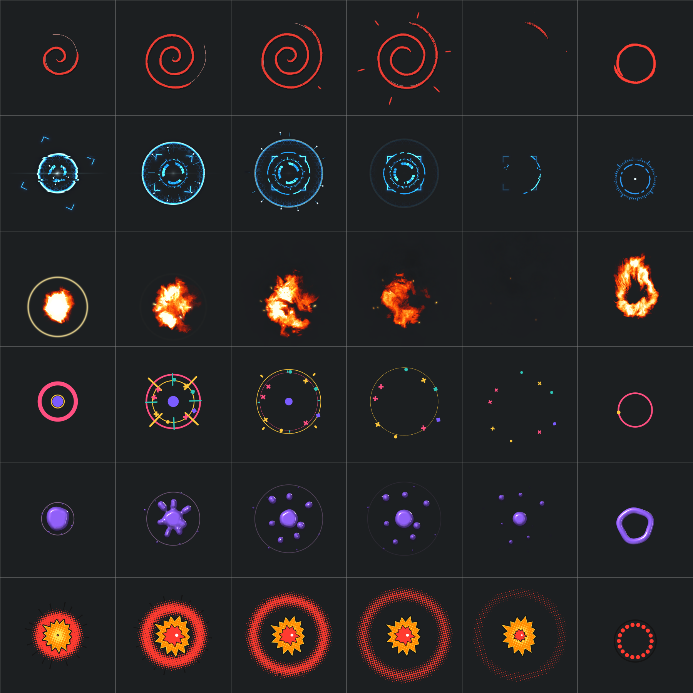

# premium_click_script

An OBS Studio Lua script (Windows) that adds a **Premium Click FX** source:
shader-driven click visualisations for screen recordings and streams, with
textures generated in Blender.



*Rendered offscreen by libobs' own D3D11 renderer (`tools/obs_render_test.py`):
one row per style, five moments of the animation, and the hold indicator on the
right. A light-backdrop version is in [docs/obs_sheet_light.png](docs/obs_sheet_light.png).*

## Styles

| Style | What happens on a click |
| --- | --- |
| **Ink Spiral** | A pencil guide line races ahead, a dry-brush ink spiral writes on over it with hand-drawn wobble that "boils" at 12 fps, emphasis dashes flick out, then the stroke writes itself off. |
| **Sci-Fi Pulse** | Fast blue HUD lock-on: anamorphic flash, chromatic shockwave with a hex-grid wake, three Blender-built HUD rings that flicker in, spin and unwind, target brackets that snap in, data streaks, glitch slices. |
| **Inferno Burst** | A white-hot ignition and heat shock, then turbulent fireballs that rise on buoyancy and cool through a Blender colour ramp, ballistic embers with motion blur, and smoke. |
| **MoGraph Pop** | Flat motion graphics: a ring that thins as it expands, trim-path burst lines, spinning confetti (triangles, squares, dots, crosses) and a popping centre dot. |
| **Liquid Splash** | Glossy goo: a wobbling blob throws teardrop droplets whose bridges stretch and snap, shaded with a matcap rendered in Blender, with a ripple and a contact shadow. |
| **Halftone Shock** | Comic pop art: a jagged burst with ink outline and halftone shading, a red core, action lines and a halftone shockwave. |

Holding a button shows a matching indicator that follows the cursor: an inked
circle, a HUD reticle, a ring of flame, an orbiting ring, a goo ring, or a
halftone dot ring. You can also set the style to **Random** or **Cycle**.

## Setup

1. Keep `premium_click_fx.lua` next to the `premium_click_fx/` folder (the
   shader and textures load from there).
2. In OBS: **Tools → Scripts → +** and pick `premium_click_fx.lua`.
3. In your scene, add a **Premium Click FX** source above your **Display Capture**.
4. In its properties, choose the same monitor as the Display Capture.
5. Give it the same transform as the capture: right-click the Display Capture,
   *Transform → Copy Transform*, then right-click the click source,
   *Transform → Paste Transform*.

The source is the size of the chosen monitor in physical pixels, so it lines up
with the capture at any resolution and on any monitor layout. Use **Preview a
click in the centre** in the properties to try styles without clicking around.

## Settings

| Setting | What it does |
| --- | --- |
| Style | One of the six styles, Random (never the same twice in a row) or Cycle |
| Size (%) | 100 % makes the effect radius 6.5 % of the capture height (70 px at 1080p, 94 px at 1440p, 140 px at 2160p), so effects keep their proportions at any resolution |
| Speed (%) | Plays every animation faster or slower |
| Opacity (%) | Overall strength |
| Fire palette | Classic fire, blue flame, violet flame or plasma (ramps from Blender) |
| Use custom colours | Replaces each style's primary and secondary colours; for the fire they become the flame and ember colours |
| Left / Right / Middle button | Which buttons trigger effects (left only by default); right clicks swap primary and secondary colours |
| Show an indicator while a button is held | Hold indicator after 0.12 s of holding; it follows drags |
| Monitor / Custom region | Which screen area the source maps to; the source follows resolution changes of the chosen monitor |

## Blender assets

All textures in `premium_click_fx/textures/` are generated by
`tools/blender/generate_textures.py`:

| Texture | Built from |
| --- | --- |
| `noise.png` | 4D Noise and Voronoi nodes sampled on a 4D torus so they tile seamlessly: fBm, cells, and domain-distorted wisps (fire turbulence, smoke) |
| `brush.png` | Anisotropic noise fields turned into a dry-brush strip: ragged coverage, bristle streaks and paper grain (ink spiral) |
| `ramps.png` | Color Ramp nodes for fire, plasma, blue flame and violet flame |
| `hud.png` | Real geometry (ticks, segmented arcs, chevrons, spectrum bars, glyph blocks) laid out in polar bands and rendered with Cycles; the channels hold coverage, a per-element id for flicker, and a glow |
| `matcap.png` | A sphere lit by area lights in Cycles, rendered three times (diffuse, sharp gloss, soft sheen) and packed into one tintable matcap (liquid) |

To rebuild them, run the script in Blender (it works in a temporary scene and
removes everything it creates):

```bash
blender -b --factory-startup -P tools/blender/generate_textures.py
```

or, from Blender's Python console:
`import runpy; runpy.run_path(r"<repo>/tools/blender/generate_textures.py", run_name="__main__")`

## Development tools

The tools run with any 64-bit Python that has numpy. Blender's bundled Python
works.

| Tool | Purpose |
| --- | --- |
| `tools/validate_effect.py` | Compiles every technique with `D3DCompile` (`ps_4_0`, like OBS) and reports warnings and instruction counts |
| `tools/obs_render_test.py` | Loads OBS's `obs.dll` and `libobs-d3d11.dll`, builds the effect with libobs' own parser and renders contact sheets offscreen |
| `tools/run_lua.py` + `tools/test_script.lua` | Runs the real script on OBS's LuaJIT with a scripted mouse and a recording `obslua`: presses, holds, taps, swapped buttons, monitors, resolution changes, teardown |
| `tools/preview/index.html` | WebGL preview that translates the same `.effect` file to GLSL: click or hold to try styles, or open `?sheet=Fire&ages=0.1,0.3,0.6` for a contact sheet. Serve the repo over HTTP first, for example `python -m http.server` from the repo root, then open `/tools/preview/` |

## Notes

- Requires OBS Studio 28 or newer. Built and checked against the libobs and
  LuaJIT that ship with OBS 33 (see Development tools).
- Windows only: the mouse is read through `user32` with LuaJIT FFI.
- Effects are clipped to the source, so they never spill outside the captured area.
- Output is premultiplied alpha, and the glowing styles add light on dark
  screens. Every style also keeps enough coverage to read on white pages.
- Very short taps between two frames are caught on a best-effort basis: Windows
  shares the "pressed since last check" flag with every program that polls the
  mouse.
- Windows hides input from non-elevated programs while an elevated (admin)
  window has focus, so clicks there are not seen unless OBS runs as admin.
- Edited the `.effect` file while OBS is running? Click the reload button in
  **Tools → Scripts** to recompile it.
