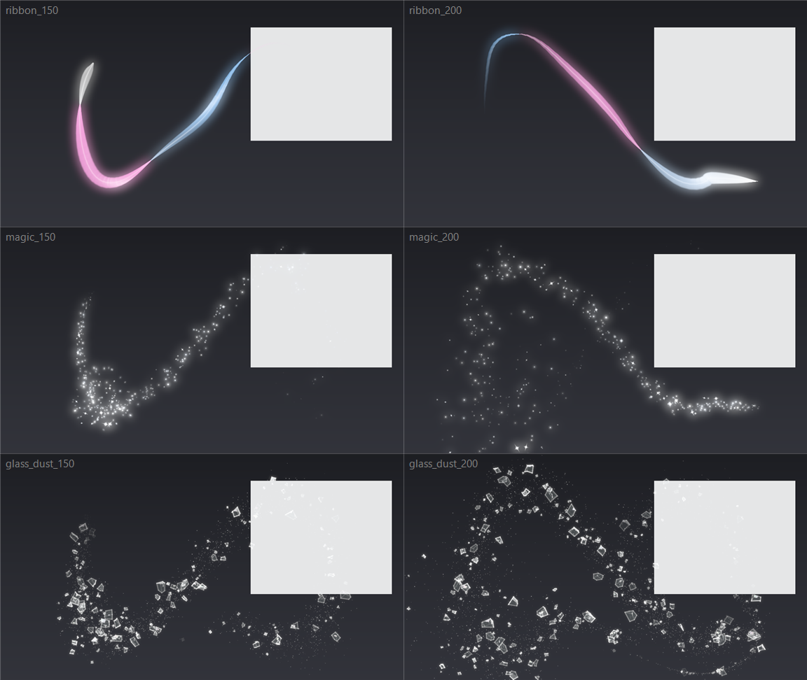

# com_sh_lua

Cursor VFX for OBS Studio on Windows: three Lua scripts, each adding its own
source that draws an effect following the mouse cursor. All simulation and
drawing run in Direct3D 11 **compute shaders**.

| Script | Source | Look |
|---|---|---|
| `cursor_ribbon.lua` | Cursor VFX: Ribbon | A twisting two-sided silk ribbon of light that flutters as it trails. |
| `cursor_magic_particles.lua` | Cursor VFX: Magic Particles | White glowing motes and twinkling four-point stars that drift upward and swirl. A click bursts them. |
| `cursor_glass_dust.lua` | Cursor VFX: Shattered Glass | Mini cubic chunks of tempered glass in a haze of fine glass dust. Chunks tumble in 3D with glowing edges and fake studio reflections sliding across their faces. The cursor stirs them up, and a click shatters a burst outwards. |



## Requirements

- Windows, OBS Studio 28 or newer (developed against OBS 33).
- The **Direct3D 11** renderer (Settings → Advanced → Video → Renderer), which
  is the default. The scripts log a warning and draw nothing under OpenGL.
- The folder must stay together: each script loads `vfx/` from its own
  directory. Keep it on a path with only ASCII characters, because Lua's file
  functions cannot open other paths on Windows.

## Setup

1. Tools → Scripts → **+** → pick one or more of the `cursor_*.lua` files.
2. In a scene, add the matching **Cursor VFX: …** source and put it above your
   display capture.
3. By default the source matches the canvas size and maps the primary monitor
   onto it. If your display capture is cropped, scaled or shows another
   monitor, set **Cursor area** to match. You can also give the effect source
   the same position and size as the capture.

Each source has three groups of settings:

- **Effect:** shape, motion and colors.
- **Look:** opacity, brightness, glow, and blending.
  - *Light over the scene* (the default) works through filters and nested scenes.
  - *Additive* is the brightest.
- **Cursor area and size:** which screen area maps onto the source, and the
  render resolution. Use 50% to save GPU time on 4K canvases.

## How it works

OBS's graphics API and its Lua bindings have no compute stage. The scripts use
LuaJIT FFI to get OBS's own `ID3D11Device` (`gs_get_device_obj`). Then they
compile HLSL with `D3DCompile` and dispatch compute shaders on OBS's immediate
context. OBS never binds anything to the compute stage, and every frame ends
with the compute stage unbound, so OBS's cached pipeline state stays valid.

Per frame, once per output frame however many times OBS draws the source:

1. **Simulate:** particles or ribbon points live in a GPU ring buffer. The CPU
   only says how many to spawn along this frame's cursor path. A sim kernel
   spawns them and moves the rest through a curl-noise flow.
2. **Draw:**
   - Particles splat into a fixed-point accumulation buffer with `InterlockedAdd`.
   - The ribbon is rasterised in compute: each segment claims pixels with
     `InterlockedMax` on (closeness, segment), which gives the distance field
     of the whole strip. A resolve pass shades the strip as a twisting
     two-sided surface.
   - Each glass chunk is a jittered box (some cut down to wedges) rotated in
     3D and rasterised in compute: face coverage and edge glow both come from
     the 12 projected edge lines. Faces reflect a made-up studio of
     rectangular soft boxes on slightly bent normals. Big chunks are queued to
     a second pass where a whole thread group shares their pixels, so no
     single thread holds up the frame.
3. **Glow and composite:** quarter-resolution separable blur, soft tonemap, and
   premultiplied RGBA16F output.
4. `CopyResource` into an OBS texture, which OBS draws with its default effect.

Bytecode is cached in `vfx/cache/`, so after the first load the scripts start
in about a millisecond.

GPU time per frame on an RTX 3070, from D3D11 timestamp queries:

| Effect | 1920×1080 | 3840×2160 |
|---|---|---|
| Ribbon | 0.35 ms | 1.3 ms |
| Magic particles | 0.50 ms | 1.4 ms |
| Shattered glass | 0.49 ms | 1.4 ms |

## Layout

```
cursor_*.lua          entry scripts (one source each)
vfx/host.lua          OBS source: settings UI, cursor mapping, GPU lifetime, drawing
vfx/d3d11.lua         D3D11 + D3DCompile bindings (FFI, vtable slots checked at load)
vfx/pipeline.lua      shared accumulation, glow chain, output, frame constants
vfx/particles.lua     ring-buffer particle system (magic, shattered glass)
vfx/effects/*.lua     per-effect parameters and per-frame logic
vfx/shaders/*.hlsl    compute kernels (common.hlsl holds noise, splats, glow, composite)
tools/                offline preview and tests (run with OBS's LuaJIT, no OBS needed)
```

## Offline preview and tests

`tools/preview.ps1` loads OBS's `lua51.dll` into PowerShell. It runs an effect
on its own D3D11 device, with the debug layer when installed, following a
scripted cursor path. It writes PNG frames and per-frame GPU timings to
`preview/`. `-Set` overrides settings by key, and `-Backdrop black` composites
on black instead of the test desktop.

```bash
pwsh -File tools/preview.ps1 -Effect ribbon
```

```bash
pwsh -File tools/preview.ps1 -Effect glass_dust -Set "shards=20,reflections=1.5" -Backdrop black
```

`tools/host_test.lua` loads the real entry script against stand-ins for
`obslua` and libobs that are backed by a real D3D11 device. It walks the source
through register, defaults, properties, create, frames, a resolution change, a
pause, destroy and unload. It fails on any debug-layer message or any D3D11
object that is left referenced.

```bash
pwsh -File tools/preview.ps1 -Script host_test.lua -Effect magic
```
